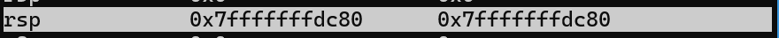

# 01.asm
RSP  is the stack pointer.

The stack points to this address when the contents of rax are pushed

The pointer decreases after the content of rcx are pushed

When popping, the pointer increases back to the original value