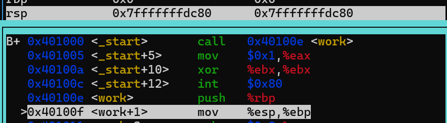
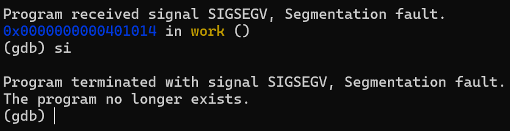

# 04.asm

The value of the rsp decreases because `call work` pushes the value of the return address to the stack

Content of rbp is also pushed to the stack

Pointer to the top of the stack is pushed to rbp. Essentially this is done when reserving stack space.

8bytes were reserved

We get a segmentation error while running. It's because I assembled it as a 64bit instead of 32bit.

